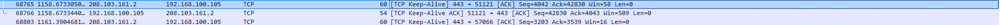

# Day 1 패킷 분석 보고서 (이름 · 2026-10-12)

> **쓰는 법**
>
> - 문제를 하나 풀 때마다 그 교시의 **문제 소제목 아래**를 채웁니다.
> - **값을 적는 줄**(끝이 `:`)은 콜론 뒤에 내 화면의 값을 씁니다.
> - **생각하는 질문**(물음표)은 아래 `답:` 뒤에, 내가 확인한 것과 그렇게 생각한 이유를 씁니다. 길어지면 다음 줄에 이어 써도 됩니다.
> - 🔍 는 그 교시에 배운 내용으로 답하는 핵심 질문입니다. 답을 못 찾았으면 「모름 — 막힌 곳: …」 을 씁니다.
> - ⭐ 도전은 선택이라 비워도 됩니다.

---

## 2교시 · ping

### 문제 2-1 · 결과 화면 읽기

- 보냄 · 받음 · 손실 · 평균:  패킷: 보냄 = 4, 받음 = 3, 손실 = 1 (25% 손실), 평균 47ms
- 손실 % 는 보낸 수와 받은 수로 어떻게 계산했나요?
  - 답: 받음 / 보냄

### 문제 2-2 · 구글 DNS 서버에 `ping` 열 번 보내기

- `8.8.8.8` 까지 평균 왕복 시간 · TTL · 받음 · 손실: 보냄 = 10, 받음 = 10, 손실 = 0 (0% 손실)

### 문제 2-3 · 이름으로 `ping` 보내기

- `google.com` 의 IP 주소: 142.250.197.110
- 이름만 입력했는데 IP 주소가 나온 이유는 무엇인가요?
  - 답: DNS를 통해 이 도메인과 연결된 IP 주소가 출력된 것 같다.

### 문제 2-4 · 두 가지 실패를 구별하기

- 두 실패 문구: Ping 요청에서 abc.nowhere-not-exist 호스트를 찾을 수 없습니다. 이름을 확인하고 다시 시도하십시오., 요청 시간이 만료되었습니다.
- 두 실패는 각각 어디에서 멈춘 것인가요?
  - 답: DNS 서버, 내 PC

### ⭐ 도전 2-5 · `ping` 결과를 파이썬으로 판정하기

- 출력 첫 줄:

### 찾아본 것

- 2.1 표에서 찾아 쓴 TTL 의 뜻과 라우터를 지날 때 바뀌는 방식:
  - Time To Live의 뜻으로 운영 체제마다 초기값이 다르다. 라우터를 하나 지날 때 마다 1씩 값이 줄어듦. 말그대로 패킷이 네트워크에서 살아남는 시간이란 뜻이다. 하지만 실제 시간은 아니고 hop(데이터 패킷이 출발지에서 목적지로 이동할 때, **라우터나 스위치 같은 네트워크 장비를 거쳐갈 때마다** 발생하는 이동 단계)을 의미함.

### 이 교시에 새로 안 것

- 이 교시에서 새로 알게 된 것:

---

## 3교시 · IP 와 MAC

### 문제 3-1 · 결과 화면 읽기

- 예시 화면의 IPv4 주소 · MAC 주소 · 기본 게이트웨이: 192.168.0.15, A4-B1-C2-D3-E4-F5, 192.168.0.1

### 문제 3-2 · 내 IP 주소 · 게이트웨이 · MAC 주소 찾기

- 찾은 장치 이름 · 내 IPv4 주소 · 기본 게이트웨이 · MAC 주소(물리적 주소): 192.168.100.105, 192.168.1.1, D8-BB-C1-40-36-48

### 문제 3-3 · 게이트웨이까지 `ping`

- 게이트웨이까지 평균 · 2-2 의 `8.8.8.8` 평균: 0ms, 35ms
- 게이트웨이까지가 더 짧은 이유는 무엇인가요?
  - 답: 네트워크상 거리가 더 짧기 때문

### 문제 3-4 · ARP 캐시 보기 — `arp -a`

- 게이트웨이 줄의 MAC 주소 · 유형: 00-10-f3-a3-fc-96  ,  동적
- 🔍 ARP 는 무엇을 알아내려고 쓰나요? 내 결과의 게이트웨이 줄을 예로 들어 설명합니다.
  - 답: MAC 주소(물리적 주소)

### ⭐ 도전 3-5 · 주소 모양으로 IP 와 MAC 구별하기

- 출력 첫 줄:

### 이 교시에 새로 안 것

- 이 교시에서 새로 알게 된 것:

---

## 4교시 · 포트

### 문제 4-1 · 직접 실행해 보기

- 출력 두 줄: HTTPS		모름
- `3389` 는 사전에 없는데도 에러 없이 둘째 줄이 나온 이유는 무엇인가요?
  - 답: 기본값을 두번재 인자로 넘겼기 때문에 그것이 출력된 것.

### 문제 4-2 · 지금의 연결 보기 — `netstat -n`

- 고른 줄의 외부 포트 → 서비스 이름: HTTPS

### 문제 4-3 · 그 연결은 어느 프로그램의 것인가

- PID → 프로그램 이름: chrome.exe

### 문제 4-4 · 내 PC 의 LISTENING 포트 찾기

- 4.1 표에 있는 LISTENING 포트 → 서비스 이름: RPC, SMB
- 🔍 LISTENING 과 ESTABLISHED 는 무엇이 다른가요? 4-2 와 4-4 에서 본 줄을 예로 들어 설명합니다.
  - 답: LISTENING은 열려있지만 연결된 서비스는 없는 것, ESTABLISHED는 이미 포트에 서비스가 실행되고 있는 것

### 문제 4-5 · 증상으로 층 좁히기

- 증상 ① · ② · ③ 에서 의심되는 층: (응용 계층) , (데이터 링크) , (응용계층)
- 증상마다 그렇게 판단한 근거는 무엇인가요?
  - 답: DNS가 해석을 못하는 것으로 의심, 같은 망안에 있는 기본 게이트웨이주소 이기 때문에, 특정 웹사이트가 안 열리면 그 사이트에 문제가 있을 수 있음

### 찾아본 것

- 4.1 표에서 찾아 쓴 3389 의 위험과 445 를 이용해 퍼진 랜섬웨어:

### 이 교시에 새로 안 것

- 이 교시에서 새로 알게 된 것:

---

## 5교시 · TCP

### 문제 5-1 · 직접 실행해 보기

- 출력 세 줄: 	True
  False
  443
- 탐지 코드에서 플래그를 `==` 로 검사하면 어떤 일이 생기나요? 둘째 줄을 근거로 설명합니다.
  - 답:  False, 리스트는 문자열이 아니다

### 문제 5-2 · TCP 일까 UDP 일까

- ① ~ ⑤ 가 각각 TCP · UDP · ICMP 중 무엇인지: TCP, UDP, TCP, UDP, ICMP
- ① 사진 파일 보내기가 TCP 인 이유는 무엇인가요?
  - 답: FTP가 TCP 기반의 프로토콜이라 or 사진 전송은 정확성이 생명이라 하나도 빠지면 안돼서 TCP를 쓴다

### 문제 5-3 · 세 번의 순서 맞히기

- 세 패킷의 순서와 방향: 내 PC ACK -> 서버, <- SYN, ACK, SYN ->
- 🔍 연결을 맺을 때는 세 번인데, 끝낼 때는 왜 네 번인가요?
  - 답: 서버에서 아직 못보내고 남은 요청이 있다면 syn ack 사이에 보내줄수도 있음

### 문제 5-4 · 같은 서버로 간 두 연결은 무엇이 다른가

- 두 연결에서 같은 것 · 다른 것: 프로토콜, 연결한 외부 주소는 같고 로컬 주소의 포트가 다르다
- 같은 서버로 간 두 연결을 무엇으로 구별하나요?
  - 답: 포트

### 이 교시에 새로 안 것

- 이 교시에서 새로 알게 된 것:

---

## 6교시 · Wireshark

### 실습 1 · 캡처하고 통신 방향 읽기

#### 문제 6-1 · Wireshark 실행하기

- 고른 인터페이스 이름: 이더넷 2

#### 문제 6-2 · 캡처한 통신의 방향 읽기

- `Packets` 숫자 · Protocol 열의 이름 세 개: 
- `숫자 → 443` 과 `443 → 숫자` 가운데 어느 줄이 요청인가요? 그렇게 판단한 이유는 무엇인가요?
  - 답: 숫자 -> 443이 요청. 443 포트가 HTTPS 기본 포트이기 때문에 내가 HTTPS가 적용된사이트로 요청하는 것이라고 판단함.

### 실습 2 · 패킷 내용을 해석하고 필터로 확인하기

#### 문제 6-3 · 패킷 하나를 층별로 펼치기

- Source MAC · Source IP / Destination IP · Time to Live · Source Port / Destination Port · Flags: 00:10:f3:a3:fc:96,  208.103.161.2 / 192.168.100.105, 56, 443 / 65258, 0x0010
- 이 패킷은 내 PC 가 보낸 것인가요, 받은 것인가요? 어떻게 알았나요?
  - 답: 받은 것이다. source 포트가 443이라서 알 수 있다.

#### 문제 6-4 · 필터 결과와 뜻 비교하기

- 전체 `Packets` · `dns` · `udp` · `tcp.port == 443` 의 `Displayed`: 378, 45553, 6465
- 필터를 걸어도 `Packets` 는 그대로인데 `Displayed` 만 바뀌는 이유는 무엇인가요?
  - 답: packets이 전체 수고 displayed는 필터에 의해 걸러져서 보여지는 개수이다.

### 이 교시에 새로 안 것

- 이 교시에서 새로 알게 된 것:

---

## 7교시 · 패킷 분석

### 문제 7-1 · 내 HTTP 연결 하나만 잡기

- 세 줄 Info 의 신호 순서: syn, [syn, ack], ack

### 문제 7-2 · HTTP 요청과 연결 종료 찾기

- 요청 줄의 Info · FIN 줄 수: 2줄
- 🔍 내 검색어가 그대로 보인 것은 HTTP 이기 때문입니다. 같은 요청을 HTTPS 로 보냈다면 어떻게 보였을까요?
  - 답: 암호화 돼서 보이거나 필터에 아예 보이지 않았을 것 같다.

### 문제 7-3 · 보고서 완성하고 올리기

- 깃허브 `network_zt` 폴더에 보고서가 보이나요: 네

### 이 교시에 새로 안 것

- 이 교시에서 새로 알게 된 것:

---

## 최종 분석 — 7교시에 완성합니다

> 오늘 잡은 **내 HTTP 연결 하나**를 처음부터 끝까지 정리합니다. 위에서 적은 6-3 · 7-1 · 7-2 의 답을 다시 보며 씁니다.

### 1. 연결이 열리는 순간 — 3-way handshake

- 세 줄의 Source → Destination 과 Info: 내 pc -> 서버, 서버 -> 내 pc, 내 pc -> 서버
- 세 줄이 오간 뒤 두 컴퓨터는 어떤 상태가 되나요?
  - 답: 연결된 상태( ESTABLISHED)

### 2. 패킷 하나를 열어 본 값 — 6-3

- 출발지 · 목적지 IP (3층) · TTL · 출발지 · 목적지 포트 (4층):  192.168.100.105, 56, 443, 65258
- 목적지 포트를 보고 어떤 서비스로 가는 패킷인지 알 수 있나요? 4.1 표를 근거로 설명합니다.
  - 답: 만약 목적지 포트가 80, 443처럼 유명한 값이면 http, https 서비스를 통하는구나 하고 알 수 있다

### 3. HTTP 요청 — 7-2

- 요청 줄에서 그대로 보인 내용: 요청의 정보, syn 인지 fin인지, 시간, 접속 패턴 등
- 이것이 보안에서 문제가 되는 이유는 무엇인가요?
  - 답: 요청을 탈취해서 악의적으로 요청을 끊거나 중간에 이상한 요청을 끼워넣는 공격을 할 수 있다.

### 4. 오늘 하루 정리

- 오늘 배운 것 가운데 가장 중요하다고 생각하는 것과 그 이유: 실제 패킷을 열어보고 3way handshaking 과정을 확인해 본 경험, 그리고 패킷안에 ip, destination 처럼 무슨 정보들이 있는지 본 것들. 막연하게 알고 있던 네트워크와 요청을 가시적으로 나타내어 한발짝 네트워크를 알게 된것같다.
