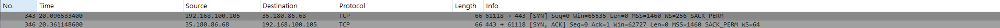
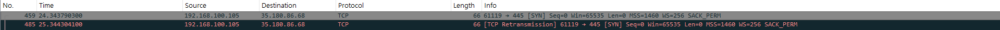

# Day 4 방화벽 규칙 보고서 · 오후 (이름 · 2026-10-15)

> **쓰는 법**
>
> - 문제를 하나 풀 때마다 그 문제 제목 아래를 채웁니다.
> - 질문마다 `쓸 내용:` 에 **무엇을 몇 가지 쓰면 되는지** 적혀 있습니다. 그대로 따라 `답:` 뒤에 씁니다.
> - 「왜 그럴까요?」 같은 질문은 한 단어로 끝내지 말고, 내 화면에서 본 값이나 배운 내용을 근거로 이유까지 씁니다.
> - 🔍 는 그 교시에 꼭 알아야 할 핵심 질문입니다. 답을 못 찾았으면 「모름 — 막힌 곳: …」 이라고 씁니다.

---

## 5교시 · 규칙 읽기 · 로그

### 문제 5-1 · 5교시 규칙표로 요청 세 개를 손으로 판정하기

- (가) 세 요청마다 처음 맞은 규칙 번호와 허용 / 차단을 적어 주세요.
  - 쓸 내용: 「A 규칙 ○ · 허용 또는 차단」처럼 세 줄
  - 답: A 규칙 3 허용
  - B 규칙 5 차단
  - C 규칙 5 차단
- (나-1) 🔍 A 와 B 는 같은 부산 지점이 같은 포트로 가는데 결과가 다릅니다. 무엇이 달라서일까요?
  - 쓸 내용: ① 두 요청에서 달라진 값 하나 ② 그 값 때문에 각각 몇 번 규칙에 맞았는지
  - 답: 포트는 같은데 가고 싶은 목적지가 달라졌다. 따라서 그 규칙때문에 업무 포털가는 요청은 3번에서 멈췄고 웹매일은 맞는 규칙이 없어서 5번 규칙에서 차단되었다
- (나-2) 🔍 5번 줄을 맨 위(1번 자리)로 올리면 A ~ C 는 각각 어떻게 될까요? 그래서 `any` 규칙은 어디에 둬야 할까요?
  - 쓸 내용: ① A ~ C 의 새 결과 ② `any` 규칙을 둘 위치와 이유
  - 답: 모두 차단하는 규칙이라 모두 1번 규칙에서 차단될 것이다. 따라서 any 규칙은 허용할 규칙에 조건이 모두 일치하지 않았을때 차단되도록 맨 마지막에 둬야 한다.

### 문제 5-2 · 허용된 연결과 막힌 연결을 Wireshark 로 재 보기

- (가-1) 80번 연결의 `[SYN]` 과 `[SYN, ACK]` 두 줄의 `Time` 값, 그리고 두 값의 차이(RTT)를 ms 로 적어 주세요.

  - 쓸 내용: `[SYN]` 줄의 `Time`, `[SYN, ACK]` 줄의 `Time`, 두 값의 차이를 ms 로 계산한 값
  - 답: 458936	2494.368378500	192.168.100.105	172.66.147.243	TCP	66	65013 → 80 [SYN] Seq=0 Win=65535 Len=0 MSS=1460 WS=256 SACK_PERM
  - 458937	2494.406666100	172.66.147.243	192.168.100.105	TCP	66	80 → 65013 [SYN, ACK] Seq=0 Ack=1 Win=65535 Len=0 MSS=1400 SACK_PERM WS=8192
  - 약 38ms 차이
- (가-2) 81번 연결에서 SYN 이 몇 번 나갔는지, 줄마다의 `Time` 값, 상대에게서 온 것(SYN/ACK · RST · 없음), `curl` 의 마지막 문구를 적어 주세요.

  - 쓸 내용: ① SYN 횟수 ② 줄마다의 `Time` 값 ③ 상대에게서 온 것 ④ `curl` 마지막 문구 한 줄
  - 답: 3번 2909 2911 2915 상대 에게 온것 없음,  curl: (28) Connection timed out after 15011 milliseconds
- (나-1) 🔍 81번 연결은 3-way handshake 의 어디에서 멈췄나요? 5.2 의 두 방식 가운데 어느 쪽이고, 그렇게 판단한 근거 화면은 무엇인가요?

  - 쓸 내용: ① 멈춘 단계(SYN · SYN/ACK · ACK 가운데) ② 드롭 / 거부 가운데 하나와 근거 화면
  - 답: SYN, 드롭이닫, 내 syn만 3번 나가고  답이 없다. 그리고 내 pc는 시간 초과
- (나-2) 81번 SYN 줄의 `Time` 값으로 SYN 사이의 간격을 구해 적어 주세요. 간격은 일정했나요, 늘어났나요?

  - 쓸 내용: ① (가-2) 의 `Time` 값으로 구한 줄 사이 간격 두 가지(앞부분 · 뒷부분, 예: 1.0초, 2.0초) ② 간격이 일정했는지, 늘어났는지
  - 답: 2초 -> 4초, 간격이 늘어남
- (다) 아래 방화벽 로그의 14:05 네 줄을 `10.8.0.21` PC 쪽에서 패킷으로 보면 어떤 모습일까요? 무엇을 하려던 기록으로 보이는지, 다음에 어떤 기록을 확인하면 좋을지도 적어 주세요.

  - 쓸 내용: ① 패킷으로 보이는 모습(무엇을 보내고 무엇이 안 왔는지) ② 목적지 · 포트 · 간격으로 본 행동 ③ 다음에 확인할 기록
  - 답: 요청을 보냈지만 아무 답이 안옴, ssh, https, mysql, postgresql

  서로 다른 서버의 관리·웹·DB 포트를 **정확히 1초 간격으로, 출발지 포트를 1씩 올리며** 차례로 두드렸으므로, 사람이 직접 접속한 것이 아니라 자동 도구로 어떤 서비스가 열려 있는지 찾는 **포트 스캔(정찰)** 으로 보인다.

  다음으로는 **VPN 접속 로그**에서 14:05에 `10.8.0.21`을 받은 계정과 접속한 공인 IP를 확인하고, **앞뒤 방화벽 로그**에서 다른 주소·포트로도 시도했는지, **차단되지 않고 허용된 접속**이 있었는지 확인한다. 또 **규칙 5**가 무엇을 막는 규칙인지 확인한다.
- (라) (선택) 사용자가 「회사 서버에 접속이 안 된다」고 합니다. 패킷만 보고 방화벽 문제인지 서버 문제인지 어떻게 나눌 수 있을까요?

  - 쓸 내용: 응답이 아예 없을 때 · RST 가 올 때 · SYN/ACK 가 올 때 각각 무엇을 의심하고 먼저 어디를 볼지. 선택 문항이라 안 쓰면 「선택 안 함」이라고 적습니다
  - 답: 응답이 아예 없으면 방화벽 DROP 이 다 막아버리는게 가장 유력,
    RST가 오면 서버에서 실행되는 프로그램이 없을 가능성 의심 하지만 드물게 방화벽에서 REJECT 해버릴수도 있음, SYN/ACK 가 오면 잘 응답이 온거라 애플리케이션 문제를 생각해봐야함

### 이 교시에 새로 안 것

- 이 교시에서 새로 알게 된 것 하나를 적어 주세요. (「이 교시에 새로 안 것」 칸)
  - 쓸 내용: 새로 안 것 하나와, 그게 왜 기억에 남는지
  - 답:

---

## 6교시 · 허용 목록 · 규칙 순서

### 문제 6-1 · 학원 방화벽은 허용 목록일까 차단 목록일까

- (가) 포트 443 · 445 · 3389 마다 「열림 · 드롭 · 거부」 판정과 근거(`curl` 문구 · Wireshark 화면)를 한 줄씩 적어 주세요.
  - 쓸 내용: 「443: 열림 — Port test successful!」처럼 포트마다 한 줄, 판정과 근거
  - 답: 443: 열림 - Port test successful!
  - 
  - 445:  드롭 - curl: (28) Connection timed out after 5015 milliseconds
  - 
  - 3389: 열림 - Port test successful!
  - 
- (나) 🔍 이 결과로 보면 학원 방화벽은 허용 목록과 차단 목록 가운데 어느 쪽에 가까운가요? 근거가 된 포트를 들어 적어 주세요.
  - 쓸 내용: ① 허용 목록 / 차단 목록 / 알 수 없음 가운데 하나 ② 근거가 된 포트와 그 결과 ③ 안내 6.1 표의 어느 줄과 맞는지
  - 답: 차단목록에 가깝다. 445 포트는 파일 공유인데 443, 3389는 열리고 위험한 포트만 막은 것 같다.
- (다-1) 포트 세 개만 보고 내린 판단에는 어떤 한계가 있을까요? 더 확실하게 알려면 무엇을 더 해야 할까요?
  - 쓸 내용: ① 한계 한 가지 ② 더 해야 할 시험 한 가지
  - 답: 샘플이 적다. 다른거 포트 더 해봐야할듯, 목적지도 다른 목적지도 많이 해봐야함.
- (다-2) 6번 필터(`tcp.flags.syn == 1 && tcp.flags.ack == 0`)로 바꾸니 2번 필터 화면에서 어떤 패킷이 사라졌나요? 한 PC 가 여러 포트로 연결을 시작한 것을 찾을 때 이 필터를 쓰는 이유는 무엇일까요?
  - 쓸 내용: ① 사라진 패킷의 종류 ② 시작 SYN 만 모아 볼 때 알 수 있는 것
  - 답:  syn ack 둘다 있는 패킷이 사라짐, 연결을 뜻하는 요청만 알 수 있음

### 문제 6-2 · 허용했는데 왜 막힐까 — 규칙 순서 고치기

- (가-1) 처음 규칙표로 판정한 세 요청의 처음 맞은 규칙 번호와 허용 · 차단을 적어 주세요.
  - 쓸 내용: 「A 규칙 ○ · 허용 또는 차단」처럼 세 줄
  - 답: A 규칙 차단, B 규칙 차단, C 규칙 차단
- (가-2) 2번과 3번을 위로 올린 규칙표로 판정한 세 요청의 처음 맞은 규칙 번호(올린 뒤의 번호)와 허용 · 차단을 적어 주세요.
  - 쓸 내용: 「A 규칙 ○ · 허용 또는 차단」처럼 세 줄
  - 답: A 허용, B 허용, C 차단
- (나) 🔍 처음 규칙표에서 업무 포털 허용 규칙(2번)이 있는데도 왜 막혔을까요?
  - 쓸 내용: ① 처음 규칙표 1번의 목적지 범위와 포트 ② 업무 포털 주소가 그 범위에 들어 있는지 ③ 그래서 2번까지 가지 못한 이유
  - 답: 1번이 차단 범위가 너무 넓어서 다 앞에서 막아버렸다
- (다) 반대로 「부산 지점(`192.168.20.0/24`) → 본사 전체(`10.10.0.0/16`) · `any` · 허용」 규칙이 「부산 지점 → 고객 DB(`10.10.30.7/32`) · `3306` · 차단」 규칙보다 위에 있으면, 부산 지점에서 고객 DB 로 가는 요청은 어떻게 될까요? 어떤 사고가 날까요?
  - 쓸 내용: ① 그 요청이 먼저 맞는 규칙 ② 그래서 생기는 사고
  - 답: 부산 지점에서 본사 전체에 접근할 수 있게 되어서 의도한 대로 동작하지 않는다. 그래서 부산 지점에 필요 이상의 권한을 주게됨

### 이 교시에 새로 안 것

- 이 교시에서 새로 알게 된 것 하나를 적어 주세요. (「이 교시에 새로 안 것」 칸)
  - 쓸 내용: 새로 안 것 하나와, 그게 왜 기억에 남는지
  - 답:

---

## 7교시 · 규칙표 직접 쓰기 · 규칙서

### 문제 7-1 · 요구사항을 읽고 규칙표 직접 쓰기

- (가) 처음 실행했을 때의 점수와, `점수: 8 / 8` 이 나올 때까지 몇 번 고쳤는지 적어 주세요.
  - 쓸 내용: 처음 점수 하나와 고친 횟수 하나
  - 답: 1/8, 1번 고침
- (나-1) 처음에 틀렸던 시험 하나를 골라, 어느 규칙이 왜 틀렸고 어떻게 고쳤는지 적어 주세요. 한 번에 8 / 8 이었다면, 위에서 다섯째 시험(지점 → 관리 서버 `443`)이 왜 차단되어야 하는지 적어 주세요.
  - 쓸 내용: ① 틀렸던 시험 번호 ② 원인이 된 규칙과 이유 ③ 고친 내용 — 한 번에 맞았으면 시험 5번이 차단되어야 하는 이유(요구사항 ② 의 「만」)
  - 답: 아무데도 허용하는 규칙이 없어서 결국 any에 걸려서 차단됨
- (나-2) 🔍 부산 지점 규칙의 목적지를 서버 하나(`/32`)가 아니라 같은 서버 범위 전체 `10.10.20.0/24` 로 적으면 8개 가운데 어느 시험이 틀릴까요? 요구사항 ② 와 비교해 이유를 적어 주세요.
  - 쓸 내용: ① 틀릴 시험 번호 ② `10.10.20.0/24` 에 들어 있는 서버들 ③ 요구사항 ② 보다 넓게 열리는 이유
  - 답: 5번 `"192.168.20.15", "10.10.20.9", 443,  "차단"),`이거 틀릴듯
    10.10.20.2 ~ 10.10.20.254 가 들어있습니다. 서브넷 마스크를 줄여서 범위를 넓혀서 넓게 열림.
- (다) 내 규칙표에서 고객 DB(`10.10.30.7`)로 가는 통신을 허용하는 규칙은 몇 줄이고, 누구에게 열려 있나요? 이것이 「DB 서버가 불필요하게 노출되지 않았는가」 기준을 어떻게 지키는지 적어 주세요.
  - 쓸 내용: ① DB 로 가는 허용 규칙 수와 그 출발지 ② 나머지(VPN 직원 · 지점 · 인터넷)가 어느 규칙에 맞는지 ③ 그래서 DB 가 노출되지 않는 이유
  - 답: 한줄이고 업무포털 서버에서 접속할 수 있음. 3306 포트는 그외에 아무도 허용하지 않았음.

### 문제 7-2 · 요구사항이 바뀌었다 — 규칙 한 줄을 어디에 넣을까

- (가) 새로 넣은 규칙 한 줄과, 규칙표에서 몇 번째에 넣었는지 적어 주세요.
  - 쓸 내용: 새 규칙 한 줄을 그대로, 그리고 몇 번째 줄인지
  - 답:  `(7, "10.8.0.50/32",    "10.10.20.9/32", 22,    "허용"), `7번째줄로 넣었습니다.
- (나-1) 🔍 출발지를 `10.8.0.50/32` 가 아니라 `10.8.0.0/24` 로 적으면 10개 가운데 어느 시험이 틀릴까요? 실제로는 어떤 일이 생길까요?
  - 쓸 내용: ① 틀릴 시험 번호 ② `10.8.0.0/24` 가 누구까지 포함하는지 ③ 실제로 생길 수 있는 일
  - 답: 10번, vpn 직원까지 포함, vpn 직원이 ssh 서버에 접근할 수 있게됨
- (나-2) 새 규칙을 「모두 차단」 줄 **아래**에 넣으면 어느 시험이 틀릴까요? 왜 그럴까요?
  - 쓸 내용: ① 틀릴 시험 번호 ② 그 요청이 먼저 맞는 규칙 번호와, 그래서 새 규칙까지 못 가는 이유
  - 답: 9번, 모두 차단 규칙을 먼저 맞음, 모두차단에서 잘려서 새 규칙까지 못감
- (다) 관리자의 VPN 주소 `10.8.0.50` 으로 허용했는데, 이 관리자의 VPN 계정 비밀번호가 탈취되면 어떻게 될까요? 방화벽 규칙만으로 막을 수 없는 이유를 오전 4-2 와 이어서 적어 주세요.
  - 쓸 내용: ① 방화벽이 보는 것과 보지 않는 것 ② 비밀번호를 탈취한 공격자가 받는 주소 ③ 오전 4-2 에서 본 VPN 의 한계와 이어서
  - 답: 방화벽은 패킷의 출발지 주소와 포트만 보고 사용자가 누구인지는 판별하지 않는다.
    공격자가 관리자의 비밀번호로 VPN에 로그인하면, VPN 서버는 진짜 관리자로 알고 **똑같이 `10.8.0.50`을 나눠 준다.** 그래서 방화벽에는 공격자의 패킷이 관리자의 것과 똑같이 보여 그대로 허용된다. 오전 4-2에서 본 것처럼 VPN은 **접속할 때 한 번만 비밀번호를 확인**하고 그 뒤로는 다시 확인하지 않으므로, 방화벽 규칙을 관리자 주소 하나로 좁혀도 그 주소를 얻는 기준이 비밀번호 하나인 이상 막을 수 없다.

### 문제 7-3 · 방화벽 규칙서 완성하고 올리기

- (가) `git status` 를 쳤을 때 빨간 목록에 줄이 몇 개였는지, 그 가운데 `.env` · `.venv` 가 있었는지 적어 주세요.
  - 쓸 내용: 줄 수 하나와 「`.env` · `.venv` 있음 / 없음」
  - 답:
- (나) 커밋 메시지를 `update` 처럼 쓰지 않고 무엇을 했는지 적어야 하는 이유는 무엇일까요? 오늘 쓸 메시지를 예로 들어 적어 주세요.
  - 쓸 내용: ① 깃허브 커밋 목록에 무엇이 보이는지 ② `update` 로 쓰면 생기는 불편 ③ 오늘 쓸 메시지 예
  - 답:

### 이 교시에 새로 안 것

- 이 교시에서 새로 알게 된 것 하나를 적어 주세요. (「이 교시에 새로 안 것」 칸)
  - 쓸 내용: 새로 안 것 하나와, 그게 왜 기억에 남는지
  - 답:

---

## 최종 방화벽 규칙서 — 7교시에 완성합니다

> 오늘 오후에 만든 **방화벽 규칙표**를, 처음 보는 사람도 왜 이렇게 썼는지 알 수 있게 정리합니다. 강의계획서의 4일 차 산출물(`day04_firewall_ruleset.md`)을 이 칸이 대신합니다. 위에서 적은 5 · 6 · 7교시의 답을 다시 보며 씁니다.

### 1. 규칙표 — 문제 7-2

- `day04_7-2_rules_admin.py` 의 `RULES = [` 줄부터 `]` 줄까지를 아래 코드 블록 안에 붙여 넣어 주세요.
  - 쓸 내용: 코드의 규칙표 그대로 — 아래 ` ```python ` 줄과 ` ``` ` 줄 사이에 붙입니다
  - 답:

```python
import ipaddress                                                    # import 로 IP 계산 모듈 ipaddress 를 불러온다
RULES = [                                                           # 요구사항 ① ~ ⑤ 를 지키는 규칙표다. 요구사항 ⑥ 규칙은 아직 없다
    (1, "10.8.0.0/24",     "10.10.20.5/32", 443,   "허용"),         # ① VPN 직원 → 업무 포털 HTTPS
    (2, "10.8.0.0/24",     "10.10.20.6/32", 443,   "허용"),         # ① VPN 직원 → 웹메일 HTTPS
    (3, "192.168.20.0/24", "10.10.20.5/32", 443,   "허용"),         # ② 지점 → 업무 포털 HTTPS
    (4, "192.168.20.0/24", "10.10.20.6/32", 443,   "허용"),         # ② 지점 → 웹메일 HTTPS
    (5, "10.10.20.5/32",   "10.10.30.7/32", 3306,  "허용"),         # ③ 업무 포털 서버 → 고객 DB
    (6, "10.10.40.10/32",  "10.10.20.9/32", 22,    "허용"),         # ④ 보안팀 관리자 PC → 관리 서버 SSH
    (7, "10.8.0.50/32",    "10.10.20.9/32", 22,    "허용"),         # ⑥ 재택 관리자
    (8, "0.0.0.0/0",       "0.0.0.0/0",     "any", "차단"),         # ⑤ 위에 없는 통신은 모두 차단
    # ⑥ 재택 관리자 규칙 한 줄을 위 7줄 가운데 알맞은 위치에 끼워 넣고, 그 아래 줄들의 번호를 1씩 늘려 다시 적는다
  
]
TESTS = [                                                           # 요구사항을 지켰는지 확인할 시험 10개다. (출발지, 목적지, 포트, 기대 결과)
    ("10.8.0.21",     "10.10.20.5", 443,  "허용"),                  # 1. VPN 직원 → 업무 포털
    ("10.8.0.21",     "10.10.20.6", 443,  "허용"),                  # 2. VPN 직원 → 웹메일
    ("10.8.0.21",     "10.10.30.7", 3306, "차단"),                  # 3. VPN 직원 → 고객 DB
    ("192.168.20.15", "10.10.20.5", 443,  "허용"),                  # 4. 부산 지점 → 업무 포털
    ("192.168.20.15", "10.10.20.9", 443,  "차단"),                  # 5. 부산 지점 → 관리 서버의 웹 관리 화면
    ("10.10.20.5",    "10.10.30.7", 3306, "허용"),                  # 6. 업무 포털 서버 → 고객 DB
    ("10.10.40.10",   "10.10.20.9", 22,   "허용"),                  # 7. 보안팀 관리자 PC → 관리 서버 SSH
    ("211.36.10.7",   "10.10.20.5", 443,  "차단"),                  # 8. VPN 없이 집에서 → 업무 포털
    ("10.8.0.50",     "10.10.20.9", 22,   "허용"),                  # 9. 재택 관리자(VPN 10.8.0.50) → 관리 서버 SSH
    ("10.8.0.21",     "10.10.20.9", 22,   "차단"),                  # 10. 다른 VPN 직원 → 관리 서버 SSH
]
score = 0                                                           # 맞힌 시험 수를 0 으로 시작한다
for src, dst, port, expect in TESTS:                                # 시험을 하나씩 꺼내 출발지 · 목적지 · 포트 · 기대 결과에 나눠 담아 반복한다
    result = "맞는 규칙 없음"                                        # 맞는 규칙이 하나도 없을 때의 결과로 시작한다
    found = False                                                   # 시험마다 「아직 맞는 규칙을 못 찾음」으로 다시 시작한다
    for no, rsrc, rdst, rport, action in RULES:                     # 규칙을 위에서부터 하나씩 꺼낸다
        if found == False:                                          # 아직 못 찾았을 때만 아래를 확인한다
            src_ok = ipaddress.ip_address(src) in ipaddress.ip_network(rsrc)   # 출발지가 규칙의 출발지 망에 들어 있으면 True
            dst_ok = ipaddress.ip_address(dst) in ipaddress.ip_network(rdst)   # 목적지가 규칙의 목적지 망에 들어 있으면 True
            port_ok = rport == "any" or rport == port               # 규칙의 포트가 "any" 이거나 요청의 포트와 같으면 True
            if src_ok and dst_ok and port_ok:                       # 세 가지가 모두 맞으면 첫 번째로 맞은 규칙이다
                result = action                                     # 그 규칙의 동작을 결과로 담는다
                found = True                                        # 찾았으므로 아래 규칙은 더 보지 않는다
    if result == expect:                                            # 결과가 기대와 같으면 아래 두 줄을 실행한다
        score = score + 1                                           # 맞힌 수를 1 늘린다
        print("맞음  ", src, "→", dst, port, ":", result)            # 맞은 시험을 출력한다
    else:                                                           # 결과가 기대와 다르면 아래 줄을 실행한다
        print("틀림  ", src, "→", dst, port, ":", result, "/ 기대:", expect)  # 틀린 시험과 기대 결과를 함께 출력한다
print("점수:", score, "/", len(TESTS))                              # 맞힌 수와 전체 시험 수를 출력한다
```

- 이 규칙표의 채점 결과(`점수:` 줄)를 적어 주세요.
  - 쓸 내용: `점수: … / 10` 한 줄
  - 답: 10 / 10

### 2. 설계 원칙 — 강의계획서의 평가 기준 세 가지

- 허용 목록(화이트리스트 · 최소 권한)을 어떻게 적용했나요?
  - 쓸 내용: ① 맨 아래 줄의 번호와 동작 ② 요구사항의 「만」을 지키려고 `/32` 로 좁힌 규칙 번호 하나와 이유
  - 답: 맨 아래 8번 규칙을 출발지 0.0.0.0/0, 목적지 0.0.0.0/0, 포트 any, 동작 차단으로 두어, 1~7번에서 허용하지 않은 통신은 모두 막았다. 또 7번 규칙은 출발지를 VPN 대역 전체(10.8.0.0/24)가 아닌 10.8.0.50/32 로 좁혔다. 요구사항이 재택 관리자만 관리 서버에 SSH로 접속하게 하는 것이므로, /24로 쓰면 10.8.0.21 같은 다른 VPN 직원도 SSH가 허용되기 때문이다.
- 규칙 순서는 어떤 원칙으로 정했나요?
  - 쓸 내용: ① 좁은 규칙과 넓은 규칙의 위치 ② 7-2 에서 새 규칙을 넣은 위치와 이유(6-2 · 7-2 참고)
  - 답: 겹치는 규칙이 없어서 모두 차단규칙 위에 허용 규칙을 넣었다.
- 고객 DB 가 불필요하게 노출되지 않도록 어떻게 했나요?
  - 쓸 내용: ① DB 로 가는 허용 규칙 번호와 출발지 ② 그 밖의 출발지가 맞는 규칙
  - 답: 5번 규칙 하나만 디비로 허용을 했다. 나머지는 어디서 출발해도 3306 포트를 통과할 수 없다.

### 3. 규칙표의 한계 — 문제 7-2 · 오전 4-2

- 이 규칙표를 지켜도 막지 못하는 경우를 하나 적고, 무엇이 더 필요한지 적어 주세요.
  - 쓸 내용: ① 막지 못하는 상황 하나(예: 계정을 빼앗긴 VPN 직원) ② 방화벽이 그것을 못 막는 이유(방화벽이 보는 것) ③ 더 필요한 확인 하나
  - 답: VPN 계정의 비밀번호를 빼앗긴 경우는 막지 못한다. 공격자가 그 계정으로 로그인하면 VPN 서버는 진짜 직원으로 알고 똑같은 VPN 주소를 나눠 준다. 방화벽은 패킷의 출발지·도착지 주소와 포트만 보고 그 주소를 쓰는 사람이 누구인지는 보지 않으므로, 규칙표를 아무리 좁혀도 공격자의 접속이 그대로 허용된다. 오전 4-2에서 본 것처럼 VPN은 접속할 때 한 번만 비밀번호를 확인하기 때문이다. 이를 막으려면 VPN 접속에 MFA(OTP 등 2단계 인증) 를 더해 비밀번호만으로는 로그인할 수 없게 해야 한다.

### 4. 오늘 하루 정리

- VPN 과 방화벽은 각각 무엇을 확인하나요? 한 줄씩 비교해 적어 주세요.
  - 쓸 내용: 「VPN: … 를 확인한다 / 방화벽: … 를 확인한다」 두 줄, 각각 언제 확인하는지도 함께
  - 답: VPN: 접속할 때 한 번, 아이디·비밀번호로 누구인지(사람) 를 확인하고 VPN 주소를 나눠 준다.
  - 방화벽: 패킷이 지나갈 때마다, 출발지·도착지 주소와 포트가 규칙에 맞는지를 확인한다. 사람은 확인하지 않는다.
